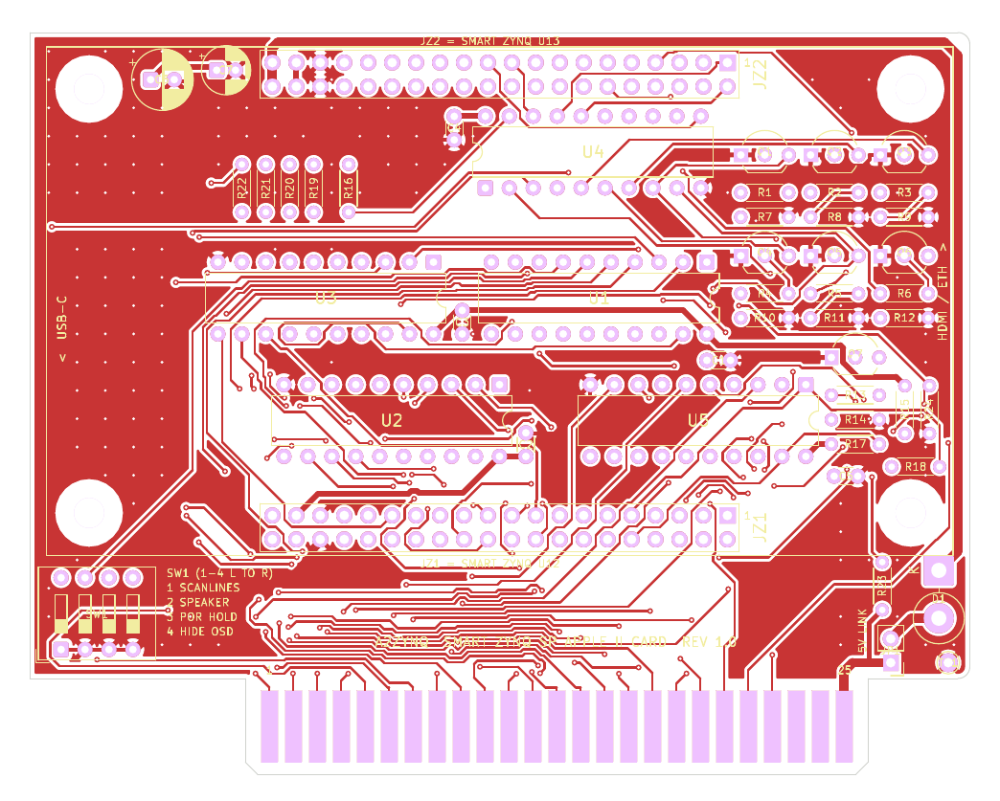

# pcb: the A2ZYNQ slot card

This is the red proto card turned into a real PCB. The circuit is exactly the
one in [../RED_PROTO_CARD_WIRING.md](../RED_PROTO_CARD_WIRING.md) and the
`../*.csv` netlists (five SN74LVC245A, Q1-Q7, the 5 V sense divider, SW1),
and the Smart Zynq SP plugs straight onto the card, so there are no ribbon
cables and no hand wiring.

> **Status: rev 1.0, not built yet.** The board passes KiCad's DRC with no
> errors, and I checked every pad against the CSV netlists. The first
> boards have not been through the Apple yet, so treat rev 1.0 as a
> prototype: order the minimum quantity and do the meter checks below before
> it goes near the IIe.

## Order it

Upload **`a2zynq_card_gerbers.zip`** to the fab (JLCPCB, PCBWay, OSH Park...).

| Setting | Value |
|---------|-------|
| Layers | 2 |
| Size | 99.7 x 78.7 mm (68.6 mm above the edge fingers) |
| Thickness | 1.6 mm (the Apple slot wants 1.57 mm / 0.062") |
| Copper | 1 oz |
| Smallest track / gap | 0.25 mm / 0.2 mm |
| Smallest hole | 0.3 mm (vias) |
| Surface finish | ENIG, or "gold fingers" if the fab offers it |
| Edge fingers | bevel (chamfer) the finger edge if offered; it makes insertion kinder to the slot |

The outline and the 50 edge fingers follow tebl's
[Apple ][ Prototyping Card](https://github.com/tebl/Apple2-Prototyping-Card)
(the compact one): same size, same finger position and pitch, so it sits in
the slot exactly like that card.

## How the Smart Zynq sits on it



- The Smart Zynq goes **component side up**, turned so its **HDMI and
  Ethernet face the back panel** of the Apple (the right-hand end of the card,
  looking at the component side with the fingers down). Its USB-C ports face
  the keyboard.
- **JZ1 = Smart Zynq U12** (bank 33, the header on the HDMI side of the
  Smart Zynq). It's the row next to the edge fingers.
- **JZ2 = Smart Zynq U13** (bank 35, the header on the Ethernet side). It's
  the row along the top edge.
- Pin 1 of both is the **square pad at the right-hand end**. Pins 35/36 are
  ground, 37/38 are 3.3 V, 39/40 are the board's 5 V, the same as on the
  Smart Zynq.
- The four M3 holes line up with the Smart Zynq's four corner holes. Use
  standoffs the same height as the header stack (about 11 mm with ordinary
  8.5 mm female headers on the card and the Smart Zynq's pins underneath).

Header and hole positions come from the board maker's dimension drawing
(`Smart_ZYNQ_SP_V1_SIZE_20230502.pdf`): header pins start 23.94 mm from the
board edge, the two pin-1 rows are 48.08 mm apart, holes 87.14 x 45 mm. Which
header is U12 comes from the Smart Zynq schematic and its ball map (bank 33
is the top half of the BGA, next to the HDMI header).

If your Smart Zynq has its header pins on the top side (they point up, for
ribbon cables), you can still use the card: fit **2x20 box headers** in JZ1
and JZ2 and run two short ribbon cables, U12 to JZ1 and U13 to JZ2, pin 1 to
pin 1. The numbering on the card is the same either way.

### Height under the Smart Zynq

Everything on the card except SW1, D1, JP1, R23 and TP1 sits under the
Smart Zynq, so keep it low:

- solder the '245s straight in or use low-profile sockets,
- push the transistors down to about 5 mm above the board,
- C6 and C7 must be **7 mm tall or less** (low-profile electrolytics).

The Smart Zynq's Ethernet jack is through-hole, and its pins come out of the
underside right above Q1-Q6, the same way the HDMI shell legs sit above Q7
and R13-R18. Before tightening the standoffs, put the board on and look along
the gap from the side: nothing on the card should touch the pins.

The Smart Zynq's microSD socket isn't on its top side (it's not on the
maker's top-view drawing), so expect to lift the board off the sockets to
swap cards. I update the card over the network anyway (see the board
README).

## Parts

Full list: [a2zynq_card_bom.csv](a2zynq_card_bom.csv). The "old schematic name"
column ties each part back to the hand-wired card and the PDF schematic
(RBASE1, ROE_IN, CDEC3 and so on).

The resistors use the small **0204 size** (3.6 mm body, 5.08 mm lead
spacing), for example Vishay SFR16S or Yageo MFR-12. The usual 1/4 W
6.3 mm resistors don't fit the footprint. Everything else is ordinary
through-hole.

Differences from the hand-wired card:

- U5 is an **SN74LVC245A** with DIR and OE# from the FPGA, as in the wiring
  notes. The old PDF schematic still shows the TXB0108; ignore that page.
- No separate ground bundle: both headers carry two ground pins each, and
  the card has ground pours on both sides. TP1 is a ground loop for a scope
  clip.
- U13 pin 27 (`pl_ready`) isn't connected to anything, same as before.

## SW1

Left-hand end of the card, next to the fingers, so it's reachable with the
Smart Zynq in place. Positions 1-4 left to right are the same as always:
1 scanlines, 2 Apple speaker on HDMI, 3 Power-on-Reset hold, 4 hide the HDMI
debug numbers (see the board README). Each switch pulls its JZ2 pin
(15-18) to ground.

## The 5 V link (JP1 and D1, optional)

Leave **JP1 open** and the card is "ground only", exactly like the wiring
notes: Apple +5V only feeds the 15k/22k sense divider and the Smart Zynq runs
from USB-C.

To run the Smart Zynq from the Apple's +5V, fit **D1 (1N5822, 3 A Schottky)
first**: it stands upright on the round pad with its band (cathode) at the
top, and the lead from the band goes down to the square pad marked K. Then
put a jumper on JP1. Apple slot pin 25 then goes through JP1 and D1 to the Smart
Zynq's 5 V (U13 pins 39/40) on a 1 mm track around the edge of the card, and
D1 stops USB power from back-feeding the Apple. Read
[docs/power.md](../../boards/a2n20v2-SmartZynq/docs/power.md) before doing
this: check the board's current on USB first, check 4.6 V or more at pin 39
under load, and keep DIP switch 3 ON.

## Before it goes in the Apple

1. Card alone, nothing fitted in the sockets yet: meter Apple finger 25 to
   26. It must not beep.
2. Fit the parts. Card alone again: finger 25 to 26 reads about 37k (the
   sense divider), not a short. Check every edge finger against its
   neighbours.
3. Smart Zynq on the card, card **not** in the Apple, board on USB-C: 3.3 V
   on pin 20 of each '245, and OE# (pin 19) high on all five. Without the
   Apple's 5 V the FPGA keeps the bus switched off, and the 10k pull-ups hold
   OE# high before the bitstream loads.
4. With the A2ZYNQ bitstream running and the card still out of the Apple,
   JZ2 pins 15-18 read 3.3 V with each switch OFF and 0 V with it ON.
5. Everything off. Card in the slot. Board first, then the Apple, and watch
   the `a2hostd` log for the detected slot.

Never plug or unplug the card (or the Smart Zynq) with either side powered.

## Files

| File | What it is |
|------|------------|
| `a2zynq_card_gerbers.zip` | Gerbers + drill files, ready to upload |
| `a2zynq_card.kicad_pcb`, `a2zynq_card.kicad_pro` | the board, opens in KiCad 9 |
| `a2zynq_card_bom.csv` | parts list |
| `top.png`, `bottom.png`, `assembly.pdf` | previews (the bottom one as seen from the back) and an assembly drawing |
| `drc.rpt` | KiCad's DRC report for the board: no errors, nothing unconnected; the warnings are silkscreen overlaps and the three footprints from my own library (JZ1, JZ2 and the edge fingers J1) |

There's no KiCad schematic for this board. The netlist is the `../*.csv`
files, and I checked every pad on the copper against them.

### Changing the board

Open `a2zynq_card.kicad_pro` in KiCad 9 and edit it in the PCB editor. Before
ordering, refill the zones (B) and run the DRC (Inspect > Design Rules
Checker). To make the fab zip the same way as the one here:

```bash
cd hardware/pcb
mkdir -p gerbers
kicad-cli pcb export gerbers --layers F.Cu,B.Cu,F.Mask,B.Mask,F.SilkS,B.SilkS,Edge.Cuts \
    --subtract-soldermask -o gerbers/ a2zynq_card.kicad_pcb
kicad-cli pcb export drill --format excellon --excellon-units mm --excellon-separate-th \
    -o gerbers/ a2zynq_card.kicad_pcb
rm -f a2zynq_card_gerbers.zip
(cd gerbers && zip -q -9 ../a2zynq_card_gerbers.zip *)
```
